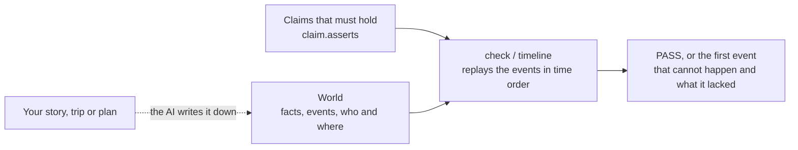
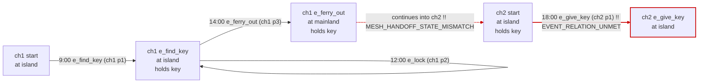

# WorldGuard

<!-- README HERO START -->
<p align="center">
  
</p>
<!-- README HERO END -->

<p align="center"><strong>Across chapters, days or steps, your AI forgets who holds what and who is where, and writes things that cannot happen. WorldGuard replays the events the AI wrote down, in time order, and names the first one that cannot happen and what it was missing.</strong></p>

| Version | Runtime | Package |
| --- | --- | --- |
| `v0.10.1` | Python 3.11+, PyYAML | `worldguard` |

[中文说明](./README.zh-CN.md)

WorldGuard is a Python tool and an agent skill (Claude Code, Codex). The AI writes a story, a trip, a plan or a process
as a small world: what is true at the start, the events with their times, what each event needs and what it changes,
and the claims that must hold. The tool replays the events and checks every claim. With original files in `texts`,
event `source` pointers also check stated times, names, codes and quantities against the actual passage.

## 30 seconds: the lighthouse key

An AI drafts two chapters:

> **Chapter 1.** At 9:00 Lena finds the brass key in the lighthouse. At 12:00 she locks the door with it. At 14:00 she
> takes the ferry to the mainland.
>
> **Chapter 2.** At 18:00, in the harbour café, Lena gives the key to Tom. At 20:00 Tom takes the evening ferry to the
> island. At 21:00 *Lena turns the brass key and the lighthouse door swings open.*

**Without WorldGuard** the last sentence goes out as written. Lena no longer has the key, and she is still on the
mainland.

**With WorldGuard** the AI writes chapter 2 as a world. Each event says who does it, where (`place`), what the actor
uses (`uses`) and what it changes; `world_model.relations` says which fact means who holds the key and who is where.
`tests/fixtures/trials/lighthouse_key/ch2_declared.yaml`:

```yaml
world_model:
  relations:
    lena_has_key: {holds: [Lena, key]}
    tom_has_key: {holds: [Tom, key]}
    lena_on_island: {at: [Lena, island]}
    lena_on_mainland: {at: [Lena, mainland]}
    tom_on_island: {at: [Tom, island]}
    tom_on_mainland: {at: [Tom, mainland]}
inputs:
  event_model: {initial_states: [lena_on_mainland, lena_has_key, door_locked, tom_on_mainland]}
  events:
    - {event_id: e_give_key, at: "18:00", source: ch2 p1, actor: Lena, with: [Tom], place: mainland, uses: [key], initiates: [tom_has_key], terminates: [lena_has_key]}
    - {event_id: e_tom_ferry, at: "20:00", source: ch2 p2, actor: Tom, place: mainland, uses: [], initiates: [tom_on_island], terminates: [tom_on_mainland]}
    - {event_id: e_unlock, at: "21:00", source: ch2 p3, actor: Lena, place: island, uses: [key], requires: [door_locked], initiates: [door_unlocked], terminates: [door_locked]}
```

The AI only wrote down what each sentence says: the unlock happens at the lighthouse and uses the key. It did not have
to remember that Lena gave the key away or that she is still on the mainland. WorldGuard works that out by replaying
the chapter:

```console
$ python skills/worldguard/scripts/run_worldguard.py timeline --contract tests/fixtures/trials/lighthouse_key/ch2_declared.yaml
world ch2 (clock: clock)
claim ch2_door_opened row 0: event e_give_key before e_unlock PASS
claim ch2_door_opened row 1: holds door_unlocked at 21:00 PASS
start  -  fluents: door_locked, lena_has_key, lena_on_mainland, tom_on_mainland | tokens: -
18:00  e_give_key  fluents: +tom_has_key -lena_has_key | tokens: = (source: ch2 p1)
20:00  e_tom_ferry  fluents: +tom_on_island -tom_on_mainland | tokens: = (source: ch2 p2)
21:00  e_unlock  fluents: +door_unlocked -door_locked | tokens: = (source: ch2 p3)  !! EVENT_RELATION_UNMET
```

`check` fails and gives the reason in the words of the declarations (part of its report):

```console
$ python skills/worldguard/scripts/run_worldguard.py check --contract tests/fixtures/trials/lighthouse_key/ch2_declared.yaml
...
      "code": "EVENT_RELATION_UNMET",
      "event_id": "e_unlock",
      "found": ["mainland"],
      "message": "Lena is not at island at 21:00 (at mainland).",
...
      "code": "EVENT_RELATION_UNMET",
      "event_id": "e_unlock",
      "found": ["Tom"],
      "message": "Lena does not hold key at 21:00 (held by Tom).",
...
  "status": "FAIL"
}
```

The fix is to let Tom open the door (`ch2_fixed.yaml` in the same folder), and the check passes. The names of the facts
play no part: `key_held_by_L` or `LenaHasKey` give the same result, because only `world_model.relations` says what
they mean.

## Quick start

**1. Install the skill for your AI, from the release tag.**

```bash
git clone --depth 1 --branch v0.10.1 https://github.com/liuyingxuvka/WorldGuard.git
python -m pip install PyYAML
python WorldGuard/scripts/install_skill.py --target ~/.claude/skills          # Claude Code
python WorldGuard/scripts/install_skill.py --target ~/.codex/skills           # Codex (or "$CODEX_HOME/skills")
python WorldGuard/scripts/install_skill.py --target ~/.claude/skills --check  # is the installed copy current?
```

The installer copies `skills/worldguard/` into `<target>/worldguard/` and puts the `worldguard/` package next to it as
`runtime/`, so the installed skill runs on its own with `python <target>/worldguard/scripts/run_worldguard.py`. Only
PyYAML is needed (JSON worlds need nothing).

**2. Optional: the `worldguard` command**, from the same tag:

```bash
python -m pip install "git+https://github.com/liuyingxuvka/WorldGuard.git@v0.10.1"
```

It installs the console command `worldguard` with the five subcommands `check`, `mesh-check`, `timeline`, `lifeline`
and `compare`, and the Python API (`GuardContract`,
`ModelMeshContract`, `run_worldguard`, `run_model_mesh`).

For source quantity conversion, add the optional `units` extra from a source checkout:
`python -m pip install ".[units]"`.
Times, dates and model checks work without it; physical units that cannot be read stay grey.

**3. The first commands**, in the cloned folder:

```bash
cd WorldGuard
python skills/worldguard/scripts/run_worldguard.py timeline --example trip
python skills/worldguard/scripts/run_worldguard.py check --example scene
python skills/worldguard/scripts/run_worldguard.py mesh-check --example story
python skills/worldguard/scripts/run_worldguard.py lifeline --example story --of key
```

`timeline` reads a world back step by step; `check` checks one world and its claims; `mesh-check` checks a tree of
chapters or days. The worlds behind `--example` are in `skills/worldguard/assets/examples/`; copy one and edit it to
start your own.

## How it works



The skill tells the AI to build a world in five steps: write the claims that must hold (`claim.asserts`); add only the
inputs those claims need (events, places and resources, spatial relations, causes); give each important claim a
known-bad edit (`variants:`) that must make it fail; for several chapters or days, a tree with one node per chapter,
joined in reading order; and a chapter not written yet as a node without a world (`GAP planned`).

The claims decide which checks run: events and time, agents and their intentions, places, resources, causes, conflicts
and norms. Results keep their order of severity, `FAIL` > `GAP` > `BOUNDARY_EXCEEDED` > `PASS`: a known contradiction
fails, a missing input is a gap, never a pass. `check` and `mesh-check` exit 0 on `PASS`, 1 otherwise, 2 on invalid
input.

A plan can also be checked against what really happened. `compare` checks the observed times and values you give it;
`--write-observed` writes an independent copy with the observed event times, leaving other inputs unchanged.
It compares only supplied IDs. Empty observations perform no validation, and matching supplied values do not
establish observation independence; the result keeps that boundary in `scope_limits`.
Checking that copy shows whether those times break the declared constraints:


```bash
python skills/worldguard/scripts/run_worldguard.py compare --contract world.yaml --observed log.yaml
python skills/worldguard/scripts/run_worldguard.py compare --contract world.yaml --observed log.yaml --write-observed actual.json
python skills/worldguard/scripts/run_worldguard.py check --contract actual.json
```

### Chapters: a tree

A chapter can be consistent on its own and still contradict the chapter before it. Suppose the AI starts chapter 2 with
Lena on the island (it forgot that she took the ferry). The tree joins the end of chapter 1 to the start of chapter 2
and catches it (`MESH_HANDOFF_STATE_MISMATCH`). Chapter 2 also fails on its own now: its hand-over says it happens on the
mainland, and the chapter starts Lena on the island (`EVENT_RELATION_UNMET`, `Lena is not at mainland at 18:00 (at
island)`). The first lines of the tree's timeline:

```console
$ python skills/worldguard/scripts/run_worldguard.py timeline --mesh tests/fixtures/trials/lighthouse_key/mesh_slip.yaml
story PASS (tree FAIL)
  ch1 PASS -> continues ch2 FAIL MESH_HANDOFF_STATE_MISMATCH
  ch2 FAIL
```

Every `check`, `mesh-check`, `timeline` and `lifeline` keeps the contradictions it finds on record in
`.worldguard/open.json` (in the checked file's folder, or the nearest folder above it that already has one), with the
chapters and events that set them up: chapter 1's ferry at `ch1 p3` and chapter 2's start for the hand-over; for chapter
2's own slip, `ch2 p1`, where Lena has to be on the mainland, and chapter 2's start, which puts her on the island. Every
later command on a file under that folder, even a check of another chapter in a new session, prints them on stderr. One
closes only when the check that found it asks the same question of its own file again and gets a pass ("Lena is at
mainland just before event e_give_key now"). While that check does not reach it (no relation or actor declared, an event
without a time, an exemption, a gap there, a Guard that no longer runs) it stays open and says why; if the story changes
so the question is no longer asked there, it closes and says what the event needs now. Renaming, moving or deleting the
chapter's file closes nothing: the entry says the file is gone, naming the path it was last seen at. When a later
check finds the same contradiction in exactly one of the files it checks under the record's folder that declare the
chapter's world (`contract_id`), the entry moves to that file with its history; found in two or more, it moves to none
and names them. A pass in such a file closes nothing, because another draft of the chapter may declare the same world:
the entry names the file where the world passed (or the files, when the world is in more than one) and the command,
`check --contract NEW.yaml --takes-over OLD.yaml`, with which you say that NEW.yaml is the gone OLD.yaml under a new
path; that check then judges the entry in NEW.yaml exactly as it judges the file's own entries. To talk it through with
a person, draw Lena's life from the model; only Lena is drawn, and the lines below the picture say what was left out:

```console
$ python skills/worldguard/scripts/run_worldguard.py lifeline --mesh tests/fixtures/trials/lighthouse_key/mesh_slip.yaml --of Lena
```



Shown: Lena, 5 boxes, 4 events; each box lists only the declared facts about Lena.
Left out: 2 events without Lena (ch2 e_tom_ferry, ch2 e_unlock); nodes without Lena: story; every fact not about Lena.

From `v0.8.0` the hand-over between chapters compares only facts both chapters name. A character who first appears in
chapter 2 (Tom) is no longer counted as "not on the mainland" at the end of chapter 1; the tree's `scope_limits`
says instead that chapter 2 starts with a fact chapter 1 never names, so the assumption stays visible.


## How it works with the other Guard skills

**WorldGuard → LogicWriting, through the saved check report.** When the story or the travel guide is written for real
readers, LogicWriting writes it and binds its plan to the world: the plan names the world file and the events each part
of the text relies on, and closure accepts the text only with a saved WorldGuard report that belongs to the current
world files. From `v0.8.0` a `mesh-check` report carries the same kind of identity as a single world's report: the tree's
`mesh_id` and the digests of every file it read (`input_digests`). A consumer that supports this tree identity can verify whether a
saved report belongs to the current files and bind a whole tree like one world. Consult
[LogicWriting's README](https://github.com/liuyingxuvka/LogicWriting) for the formats its current version accepts. WorldGuard itself never writes
prose and never calls LogicWriting.


WorldGuard is for stories, trips, plans and processes. For software code or its behaviour, use FlowGuard.

<!-- BEGIN GUARD FAMILY TABLE -->
## The Guard family

Five skills, one idea: each one checks the AI's answer against an explicit model or evidence record, and lets a tool, not the AI, do the step where the AI tends to slip. Each skill works on its own. The only data hand-over is LogicWriting reading the saved reports of ResearchGuard and WorldGuard.

| Skill | The AI weakness it makes up for | Use it when | Works with the others |
|---|---|---|---|
| [FlowGuard](https://github.com/liuyingxuvka/FlowGuard) | It changes one part of the software and does not see what that broke elsewhere; it rebuilds what already exists, or puts new code in the wrong place | you change, extend, refactor or audit software code, including the code of a simulation | Sends calculation results to PhysicsGuard, causal claims to ResearchGuard, story or plan consistency to WorldGuard, long texts to LogicWriting. The other four Guards are developed with FlowGuard |
| [PhysicsGuard](https://github.com/liuyingxuvka/PhysicsGuard) | It does physics in its head and is confidently wrong about units, signs and balances | a number comes from physics: a simulation result, test data, or a calculation the AI made itself | Sends simulation code to FlowGuard. LogicWriting reads its saved status and source summary |
| [ResearchGuard](https://github.com/liuyingxuvka/ResearchGuard) | It tells a confident causal story that its sources do not support | before a causal or evidential conclusion is stated: claims, sources, timelines, competing explanations | LogicWriting reads its saved status report. Sends the writing of the finished report to LogicWriting |
| [WorldGuard](https://github.com/liuyingxuvka/WorldGuard) | Across chapters, days or steps it forgets who holds what and who is where, and writes events that cannot happen | a story, trip, plan or process must stay consistent from step to step | LogicWriting reads its saved check report. Optional quantity conversion uses PhysicsGuard's unit table; software code goes to FlowGuard |
| [LogicWriting](https://github.com/liuyingxuvka/LogicWriting) | In a long text it drifts away from its own plan and evidence | you need a finished piece for real readers: an investigation report, a paper, fiction or a story plan, a travel guide | Reads the saved reports of ResearchGuard and WorldGuard. Sends the checking of claims on their own to ResearchGuard |
<!-- END GUARD FAMILY TABLE -->

## Honest limits

**What it does not do.**
- It reads only pointed original passages, not arbitrary prose meaning. Use `texts: {ch: chapter.md}` and event
  `source: ch p3 "quoted words"` (CSV: `tt r3 arr`). Pronouns, unreadable units and ambiguous readings stay grey;
  without originals, a model pass is only an AI transcription. See the [source inputs](skills/worldguard/references/worldguard-contracts.md).
- A `PASS` holds for the declared world and its scope, not for the real world. WorldGuard is not a physics solver, a
  legal judgment, a safety certificate or a market prediction.

**Where it can still miss.** If the AI writes the same mistake into the world that it wrote into the story, the world is
consistent and nothing fails. In the round-11 trial the unlock event required only that the door was locked, and the
chapter passed; v0.8.0 then matched actor names inside fact names, which five of six cheap rewrites still slipped past
(another actor fact, camel case, initials, no actor). From v0.9.0 nothing is guessed from names or taken from
`requires`: an event with an actor must say `place` and `uses`, and WorldGuard checks them against the declared
`world_model.relations` by replaying the world (otherwise `GAP EVENT_ACTOR_STATE_UNCHECKED`). Once a world declares any
relation, every event must name its actor. An event that truly depends on no one's state says so with
`actor_state_free: <reason>`, which the report and the timeline print. Two things the declarations cannot reach are
written into `scope_limits` instead of passing silently: a world that names no actor and declares no relation ("who
holds what and who is where are not checked"), and an event that changes facts no relation ties to anyone or anything
(Lena "unlocks" the door on the mainland: only her own place is checked, because the door has no declared place;
declare `{at: [door, island]}` and name the door in `with`, and the wrong place is a GAP). What remains the modeller's
job: naming the right place and the things an event uses, and declaring the relations at all.

**What has been measured, and what has not.**
- Reported in the design packet: one small trial during the design of this release, on the two lighthouse chapters above, with one planted
  mistake. WorldGuard named the impossible event and exactly what it lacked; a slip at the chapter boundary was caught
  only by the tree; the planted mistake written into the world itself (the unlock that required only a locked door)
  passed, which is why this release adds the actor-state check. The same trial showed a false mismatch for a character
  who first appears in chapter 2, fixed in this release.
- The design packet reports that modelling the two chapters took about three times as many characters of YAML as the story itself, and
  about 9,000 tokens of reading and output in total.
- Re-run for v0.9.0: the six round-12 variants of the lighthouse mistake (`tests/fixtures/trials/lighthouse_key/w3/`)
  are all GAP now, each with a row on the unlock event, except the one that states `actor_state_free`, whose reason is
  printed; the declared chapter fails with the two relations above. The declared chapter with no actor on any event is
  GAP; the same chapter with the unlock moved to the mainland and using nothing passes, with that event listed in
  `scope_limits`.
- Not measured: how often these checks fire on stories that are fine. They were tried on the trial chapters and the
  repository's own worlds only; declaring the relations there took one line per fact.


## Developing WorldGuard

Run the whole test suite before each commit. CI runs it again on Python 3.11 and 3.13 through
`python -m flowguard check --all`, including the declared intent checks.

```bash
python -m pip install -e ".[test]"
python -m pytest -q
```

`tests/error_policy.py` lists every error handler in WorldGuard, its scripts, skill launcher and tests that can finish
without raising, with how many there are in each function, what each does, why it is needed and the sentence of the
written rule it serves. `tests/test_error_handlers.py` checks this policy against the shared source map and the quoted
sentences against their files. A test or a
test module that ends skipped or expected to fail, or a run cut short, fails. Invalid input, including a file that
cannot be read, raises `WorldInputError` (exit 2); any other error is a fault and is raised with its traceback.

The `test` extra adds pytest and FlowGuard, which WorldGuard uses to maintain itself; the extra pins the FlowGuard
release this version is developed with. FlowGuard is installed only from its git tag
(`git+https://github.com/liuyingxuvka/FlowGuard.git@<tag>`), because the package with that name on PyPI is a different
project. Ordinary use of WorldGuard does not need FlowGuard. AI contributors start from [`AGENTS.md`](./AGENTS.md);
`CLAUDE.md` points Claude Code to the same file. `worldguard/` holds the runtime, `skills/worldguard/` the skill, its
references and example worlds, `tests/` the tests, `openspec/specs/` the specifications.


## Links

- The skill: [`SKILL.md`](./skills/worldguard/SKILL.md) and its references:
  [contracts and results](./skills/worldguard/references/worldguard-contracts.md),
  [Guard inputs](./skills/worldguard/references/guard-inputs.md),
  [trees of chapters or days](./skills/worldguard/references/model-mesh.md)
- Example worlds: [`skills/worldguard/assets/examples/`](./skills/worldguard/assets/examples/scene_locked_door.yaml)
- [Changelog](./CHANGELOG.md)
- No license file is included; source visibility alone grants no unrestricted reuse.
