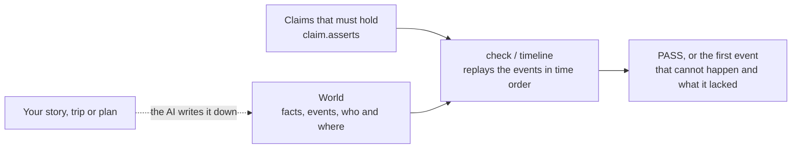

# WorldGuard

<!-- README HERO START -->
<p align="center">
  
</p>
<!-- README HERO END -->

<p align="center"><strong>Across chapters, days or steps, your AI forgets who holds what and who is where, and writes things that cannot happen. WorldGuard replays the events the AI wrote down, in time order, and names the first one that cannot happen and what it was missing.</strong></p>

| Version | Runtime | Package |
| --- | --- | --- |
| `v0.8.0` | Python 3.11+, PyYAML | `worldguard` |

[中文说明](./README.zh-CN.md)

WorldGuard is a Python tool and an agent skill (Claude Code, Codex). The AI writes a story, a trip, a plan or a process
as a small world: what is true at the start, the events with their times, what each event needs and what it changes,
and the claims that must hold. The tool, not the AI, replays the events and checks every claim. It never reads the
prose; it checks the world the AI wrote down.

## 30 seconds: the lighthouse key

An AI drafts two chapters:

> **Chapter 1.** At 9:00 Lena finds the brass key in the lighthouse. At 12:00 she locks the door with it. At 14:00 she
> takes the ferry to the mainland.
>
> **Chapter 2.** At 18:00, in the harbour café, Lena gives the key to Tom. At 20:00 Tom takes the evening ferry to the
> island. At 21:00 *Lena turns the brass key and the lighthouse door swings open.*

**Without WorldGuard** the last sentence goes out as written. Lena no longer has the key, and she is still on the
mainland.

**With WorldGuard** the AI writes chapter 2 as a world. Each event says who does it, what must be true for it to happen
(`requires`) and what it changes; the key and the places are facts that events start and end. The events of
`tests/fixtures/trials/lighthouse_key/ch2.yaml`:

```yaml
inputs:
  event_model: {initial_states: [lena_on_mainland, lena_has_key, door_locked, tom_on_mainland]}
  events:
    - {event_id: e_give_key, at: "18:00", source: ch2 p1, actor: Lena, with: [Tom], requires: [lena_has_key, lena_on_mainland, tom_on_mainland], initiates: [tom_has_key], terminates: [lena_has_key]}
    - {event_id: e_tom_ferry, at: "20:00", source: ch2 p2, actor: Tom, requires: [tom_on_mainland], initiates: [tom_on_island], terminates: [tom_on_mainland]}
    - {event_id: e_unlock, at: "21:00", source: ch2 p3, actor: Lena, requires: [lena_has_key, lena_on_island, door_locked], initiates: [door_unlocked], terminates: [door_locked]}
```

The chapter's claim, also in the file, is that the key changes hands before the door is unlocked and that the door is
open at 21:00.

Then it reads the world back:


```console
$ python skills/worldguard/scripts/run_worldguard.py timeline --contract tests/fixtures/trials/lighthouse_key/ch2.yaml
world ch2 (clock: clock)
claim ch2_door_opened row 0: event e_give_key before e_unlock PASS
claim ch2_door_opened row 1: holds door_unlocked at 21:00 FAIL CLAIM_ASSERTION_FALSE
start  -  fluents: door_locked, lena_has_key, lena_on_mainland, tom_on_mainland | tokens: -
18:00  e_give_key  fluents: +tom_has_key -lena_has_key | tokens: = (source: ch2 p1)
20:00  e_tom_ferry  fluents: +tom_on_island -tom_on_mainland | tokens: = (source: ch2 p2)
21:00  e_unlock  fluents: = | tokens: = (source: ch2 p3)  !! EVENT_PRECONDITION_UNMET
```

The 21:00 event cannot happen, so the door never opens and the chapter's own claim ("the door is open at 21:00")
fails. `check` gives the reason in full; this is the part of its report about that event:


```console
$ python skills/worldguard/scripts/run_worldguard.py check --contract tests/fixtures/trials/lighthouse_key/ch2.yaml
...
      "code": "EVENT_PRECONDITION_UNMET",
      "counterexample": {
        "at": "21:00",
        "event_id": "e_unlock",
        "holding_fluents": [
          "door_locked",
          "lena_on_mainland",
          "tom_has_key",
          "tom_on_island"
        ],
        "missing_fluents": [
          "lena_has_key",
          "lena_on_island"
        ],
        "source": "ch2 p3"
      },
...
  "status": "FAIL"
}
```

Lena lacks the key and is not on the island; Tom has the key and is. The fix is to let Tom open the door
(`ch2_fixed.yaml` in the same folder), and the check passes.

## Quick start

**1. Install the skill for your AI, from the release tag.**

```bash
git clone --depth 1 --branch v0.8.0 https://github.com/liuyingxuvka/WorldGuard.git
python -m pip install PyYAML
python WorldGuard/scripts/install_skill.py --target ~/.claude/skills          # Claude Code
python WorldGuard/scripts/install_skill.py --target ~/.codex/skills           # Codex (or "$CODEX_HOME/skills")
python WorldGuard/scripts/install_skill.py --target ~/.claude/skills --check  # is the installed copy current?
```

The installer copies `skills/worldguard/` into `<target>/worldguard/` and puts the `worldguard/` package next to it as
`runtime/`, so the installed skill runs on its own with `python <target>/worldguard/scripts/run_worldguard.py`. Only
PyYAML is needed (JSON worlds need nothing).

**2. Optional: the `worldguard` command**, from the same tag:

```bash
python -m pip install "git+https://github.com/liuyingxuvka/WorldGuard.git@v0.8.0"
```

It installs the console command `worldguard` with the four subcommands `check`, `mesh-check`, `timeline` and
`compare`, and the Python API (`GuardContract`,
`ModelMeshContract`, `run_worldguard`, `run_model_mesh`).

**3. The first commands**, in the cloned folder:

```bash
cd WorldGuard
python skills/worldguard/scripts/run_worldguard.py timeline --example trip
python skills/worldguard/scripts/run_worldguard.py check --example scene
python skills/worldguard/scripts/run_worldguard.py mesh-check --example story
```

`timeline` reads a world back step by step; `check` checks one world and its claims; `mesh-check` checks a tree of
chapters or days. The worlds behind `--example` are in `skills/worldguard/assets/examples/`; copy one and edit it to
start your own.

## How it works



The skill tells the AI to build a world in five steps: write the claims that must hold (`claim.asserts`); add only the
inputs those claims need (events, places and resources, spatial relations, causes); give each important claim a
known-bad edit (`variants:`) that must make it fail; for several chapters or days, a tree with one node per chapter,
joined in reading order; and a chapter not written yet as a node without a world (`GAP planned`).

The claims decide which checks run: events and time, agents and their intentions, places, resources, causes, conflicts
and norms. Results keep their order of severity, `FAIL` > `GAP` > `BOUNDARY_EXCEEDED` > `PASS`: a known contradiction
fails, a missing input is a gap, never a pass. `check` and `mesh-check` exit 0 on `PASS`, 1 otherwise, 2 on invalid
input.

A plan can also be checked against what really happened. `compare` checks the observed times and values you give it;
`--write-observed` writes an independent copy with the observed event times, leaving other inputs unchanged.
Checking that copy shows whether those times break the declared constraints:


```bash
python skills/worldguard/scripts/run_worldguard.py compare --contract world.yaml --observed log.yaml
python skills/worldguard/scripts/run_worldguard.py compare --contract world.yaml --observed log.yaml --write-observed actual.json
python skills/worldguard/scripts/run_worldguard.py check --contract actual.json
```

### Chapters: a tree

A chapter can be consistent on its own and still contradict the chapter before it. Suppose the AI starts chapter 2 with
Lena on the island (it forgot that she took the ferry). Chapter 2 alone passes; the tree joins the end of chapter 1 to
the start of chapter 2 and catches it:


```console
$ python skills/worldguard/scripts/run_worldguard.py timeline --mesh tests/fixtures/trials/lighthouse_key/mesh_slip.yaml | head -3
story PASS (tree FAIL)
  ch1 PASS -> continues ch2 FAIL MESH_HANDOFF_STATE_MISMATCH
  ch2 PASS
```

From `v0.8.0` the hand-over between chapters compares only facts both chapters name. A character who first appears in
chapter 2 (Tom) is no longer counted as "not on the mainland" at the end of chapter 1; the tree's `scope_limits`
says instead that chapter 2 starts with a fact chapter 1 never names, so the assumption stays visible.


## How it works with the other Guard skills

**WorldGuard → LogicWriting, through the saved check report.** When the story or the travel guide is written for real
readers, LogicWriting writes it and binds its plan to the world: the plan names the world file and the events each part
of the text relies on, and closure accepts the text only with a saved WorldGuard report that belongs to the current
world files. From `v0.8.0` a `mesh-check` report carries the same kind of identity as a single world's report: the tree's
`mesh_id` and the digests of every file it read (`input_digests`). A consumer that supports this tree identity can verify whether a
saved report belongs to the current files and bind a whole tree like one world. Consult
[LogicWriting's README](https://github.com/liuyingxuvka/LogicWriting) for the formats its current version accepts. WorldGuard itself never writes
prose and never calls LogicWriting.


WorldGuard is for stories, trips, plans and processes. For software code or its behaviour, use FlowGuard.

<!-- BEGIN GUARD FAMILY TABLE -->
## The Guard family

Five skills, one idea: each one checks the AI's answer against an explicit model or evidence record, and lets a tool, not the AI, do the step where the AI tends to slip. Each skill works on its own. The only data hand-over is LogicWriting reading the saved reports of ResearchGuard and WorldGuard.

| Skill | The AI weakness it makes up for | Use it when | Works with the others |
|---|---|---|---|
| [FlowGuard](https://github.com/liuyingxuvka/FlowGuard) | It changes one part of the software and does not see what that broke elsewhere; it rebuilds what already exists, or puts new code in the wrong place | you change, extend, refactor or audit software code, including the code of a simulation | Sends calculation results to PhysicsGuard, causal claims to ResearchGuard, story or plan consistency to WorldGuard, long texts to LogicWriting. The other four Guards are developed with FlowGuard |
| [PhysicsGuard](https://github.com/liuyingxuvka/PhysicsGuard) | It does physics in its head and is confidently wrong about units, signs and balances | a number comes from physics: a simulation result, test data, or a calculation the AI made itself | Sends the simulation's code to FlowGuard. No other Guard reads its reports |
| [ResearchGuard](https://github.com/liuyingxuvka/ResearchGuard) | It tells a confident causal story that its sources do not support | before a causal or evidential conclusion is stated: claims, sources, timelines, competing explanations | LogicWriting reads its saved status report. Sends the writing of the finished report to LogicWriting |
| [WorldGuard](https://github.com/liuyingxuvka/WorldGuard) | Across chapters, days or steps it forgets who holds what and who is where, and writes events that cannot happen | a story, trip, plan or process must stay consistent from step to step | LogicWriting reads its saved check report. Sends software code to FlowGuard |
| [LogicWriting](https://github.com/liuyingxuvka/LogicWriting) | In a long text it drifts away from its own plan and evidence | you need a finished piece for real readers: an investigation report, a paper, fiction or a story plan, a travel guide | Reads the saved reports of ResearchGuard and WorldGuard. Sends the checking of claims on their own to ResearchGuard |
<!-- END GUARD FAMILY TABLE -->

## Honest limits

**What it does not do.**
- It never reads the prose. It checks the world the AI wrote down; whether that world matches the text is the AI's job.
  `source:` on an event only points at the original passage and is not checked.
- A `PASS` holds for the declared world and its scope, not for the real world. WorldGuard is not a physics solver, a
  legal judgment, a safety certificate or a market prediction.

**Where it can still miss.** If the AI writes the same mistake into the world that it wrote into the story, the world is
consistent and nothing fails. In the trial below, the AI's unlock event first required only that the door was locked;
the chapter passed. From `v0.8.0` an event whose actor's state the world tracks (Lena's key, Lena's place) but whose
`requires` names none of it is `GAP EVENT_ACTOR_STATE_UNCHECKED`; an event that truly depends on neither says so with
`actor_state_free: <reason>`, which the report prints. It matches actor ids to complete alphanumeric segments in fluent names, without regard to case. One matching
requirement suffices; other necessary conditions and facts omitted from the world remain the modeller's responsibility.


**What has been measured, and what has not.**
- Reported in the design packet: one small trial during the design of this release, on the two lighthouse chapters above, with one planted
  mistake. WorldGuard named the impossible event and exactly what it lacked; a slip at the chapter boundary was caught
  only by the tree; the planted mistake written into the world itself (the unlock that required only a locked door)
  passed, which is why this release adds the actor-state check. The same trial showed a false mismatch for a character
  who first appears in chapter 2, fixed in this release.
- The design packet reports that modelling the two chapters took about three times as many characters of YAML as the story itself, and
  about 9,000 tokens of reading and output in total.
- Not measured: how often the actor-state check fires on stories that are fine. It was tried on the trial chapters and
  the repository's own worlds only; there it flagged exactly the planted mistake.


## Developing WorldGuard

During development, run the affected tests and models selected by FlowGuard. The final frozen source receives the
whole test suite in CI (`python -m pytest -q`); a local full run is unnecessary solely to repeat that same-source CI.

```bash
python -m pip install -e ".[test]"
python -m flowguard change --run
```

The `test` extra adds pytest and FlowGuard, which WorldGuard uses to maintain itself; the extra pins the FlowGuard
release this version is developed with. FlowGuard is installed only from its git tag
(`git+https://github.com/liuyingxuvka/FlowGuard.git@<tag>`), because the package with that name on PyPI is a different
project. Ordinary use of WorldGuard does not need FlowGuard. AI contributors start from [`AGENTS.md`](./AGENTS.md);
`CLAUDE.md` points Claude Code to the same file. `worldguard/` holds the runtime, `skills/worldguard/` the skill, its
references and example worlds, `tests/` the tests, `openspec/specs/` the specifications.


## Links

- The skill: [`SKILL.md`](./skills/worldguard/SKILL.md) and its references:
  [contracts and results](./skills/worldguard/references/worldguard-contracts.md),
  [Guard inputs](./skills/worldguard/references/guard-inputs.md),
  [trees of chapters or days](./skills/worldguard/references/model-mesh.md)
- Example worlds: [`skills/worldguard/assets/examples/`](./skills/worldguard/assets/examples/scene_locked_door.yaml)
- [Changelog](./CHANGELOG.md)
- No license file is included; source visibility alone grants no unrestricted reuse.
