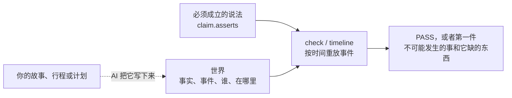
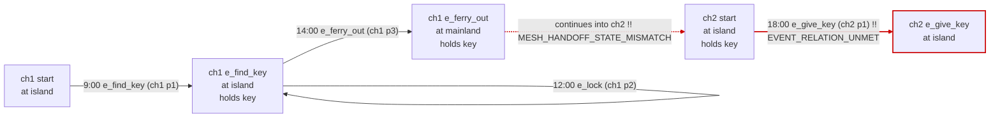

# WorldGuard

<!-- README HERO START -->
<p align="center">
  
</p>
<!-- README HERO END -->

<p align="center"><strong>章节一多、天数一长，AI 就记不清谁手里有什么、谁在哪里，写出根本不可能发生的事。WorldGuard 把 AI 记下的事件按时间重放一遍，指出第一件不可能发生的事，以及它缺了什么。</strong></p>

| 版本 | 运行环境 | 包名 |
| --- | --- | --- |
| `v0.10.1` | Python 3.11+，PyYAML | `worldguard` |

[English](./README.md)

WorldGuard 是一个 Python 工具，也是一个 AI 技能（Claude Code、Codex 都能用）。AI 把故事、行程、计划或流程写成一个小小的
“世界”：一开始什么为真，有哪些事件、各在什么时间，每件事需要什么前提、改变了什么，以及哪些说法必须成立。
工具重放事件、检查说法。声明 `texts` 原件和事件 `source` 指针后，还会直接核对原文中的时间、人名、编号和数量。

## 30 秒看懂：灯塔的钥匙

AI 起草了两章：

> **第 1 章。** 9:00，Lena 在灯塔里找到一把黄铜钥匙。12:00，她用它锁上了门。14:00，她坐渡船去了大陆。
>
> **第 2 章。** 18:00，在港口咖啡馆，Lena 把钥匙交给了 Tom。20:00，Tom 坐晚班渡船上岛。21:00，*Lena 转动黄铜钥匙，
> 灯塔的门开了。*

**没有 WorldGuard**，最后这句就这样交出去了。可钥匙已经不在 Lena 手里，她人也还在大陆上。

**用 WorldGuard**，AI 把第 2 章写成一个世界。每个事件写明谁来做、在哪里做（`place`）、用到什么东西（`uses`）、
改变了什么；`world_model.relations` 写明哪条事实表示钥匙在谁手里、谁在哪里。
`tests/fixtures/trials/lighthouse_key/ch2_declared.yaml`：

```yaml
world_model:
  relations:
    lena_has_key: {holds: [Lena, key]}
    tom_has_key: {holds: [Tom, key]}
    lena_on_island: {at: [Lena, island]}
    lena_on_mainland: {at: [Lena, mainland]}
    tom_on_island: {at: [Tom, island]}
    tom_on_mainland: {at: [Tom, mainland]}
inputs:
  event_model: {initial_states: [lena_on_mainland, lena_has_key, door_locked, tom_on_mainland]}
  events:
    - {event_id: e_give_key, at: "18:00", source: ch2 p1, actor: Lena, with: [Tom], place: mainland, uses: [key], initiates: [tom_has_key], terminates: [lena_has_key]}
    - {event_id: e_tom_ferry, at: "20:00", source: ch2 p2, actor: Tom, place: mainland, uses: [], initiates: [tom_on_island], terminates: [tom_on_mainland]}
    - {event_id: e_unlock, at: "21:00", source: ch2 p3, actor: Lena, place: island, uses: [key], requires: [door_locked], initiates: [door_unlocked], terminates: [door_locked]}
```

AI 只写下每句话本身说的：开门发生在灯塔，用到了钥匙。它不必记得 Lena 已经把钥匙交了出去、人还在大陆上；
WorldGuard 把这一章重放一遍，自己算出来：

```console
$ python skills/worldguard/scripts/run_worldguard.py timeline --contract tests/fixtures/trials/lighthouse_key/ch2_declared.yaml
world ch2 (clock: clock)
claim ch2_door_opened row 0: event e_give_key before e_unlock PASS
claim ch2_door_opened row 1: holds door_unlocked at 21:00 PASS
start  -  fluents: door_locked, lena_has_key, lena_on_mainland, tom_on_mainland | tokens: -
18:00  e_give_key  fluents: +tom_has_key -lena_has_key | tokens: = (source: ch2 p1)
20:00  e_tom_ferry  fluents: +tom_on_island -tom_on_mainland | tokens: = (source: ch2 p2)
21:00  e_unlock  fluents: +door_unlocked -door_locked | tokens: = (source: ch2 p3)  !! EVENT_RELATION_UNMET
```

`check` 判为失败，并用声明里的词说出原因（报告的一部分）：

```console
$ python skills/worldguard/scripts/run_worldguard.py check --contract tests/fixtures/trials/lighthouse_key/ch2_declared.yaml
...
      "code": "EVENT_RELATION_UNMET",
      "event_id": "e_unlock",
      "found": ["mainland"],
      "message": "Lena is not at island at 21:00 (at mainland).",
...
      "code": "EVENT_RELATION_UNMET",
      "event_id": "e_unlock",
      "found": ["Tom"],
      "message": "Lena does not hold key at 21:00 (held by Tom).",
...
  "status": "FAIL"
}
```

改法是让 Tom 去开门（同一目录里的 `ch2_fixed.yaml`），检查就通过了。事实叫什么名字不起作用：写成 `key_held_by_L`
或 `LenaHasKey` 结果一样，因为它们的意思只由 `world_model.relations` 规定。

## 快速上手

**1. 从发布的 tag 安装技能。**

```bash
git clone --depth 1 --branch v0.10.1 https://github.com/liuyingxuvka/WorldGuard.git
python -m pip install PyYAML
python WorldGuard/scripts/install_skill.py --target ~/.claude/skills          # Claude Code
python WorldGuard/scripts/install_skill.py --target ~/.codex/skills           # Codex (or "$CODEX_HOME/skills")
python WorldGuard/scripts/install_skill.py --target ~/.claude/skills --check  # is the installed copy current?
```

安装脚本把 `skills/worldguard/` 复制到 `<目标>/worldguard/`，并把 `worldguard/` 这个包放在旁边的 `runtime/` 里，
所以装好的技能可以独立运行：`python <目标>/worldguard/scripts/run_worldguard.py`。只需要 PyYAML（用 JSON 写的世界连它都不需要）。

**2. 可选：`worldguard` 命令**，同一个 tag：

```bash
python -m pip install "git+https://github.com/liuyingxuvka/WorldGuard.git@v0.10.1"
```

装好后有 `worldguard` 命令（五个子命令：`check`、`mesh-check`、`timeline`、`lifeline`、`compare`），以及 Python 接口（`GuardContract`、`ModelMeshContract`、
`run_worldguard`、`run_model_mesh`）。

需要原件数量换算时，可在源码目录中装 `units` 可选依赖：
`python -m pip install ".[units]"`。
时间、日期和模型检查不需要它；不能读出的物理单位为灰。

**3. 先跑这三条**，在克隆下来的目录里：

```bash
cd WorldGuard
python skills/worldguard/scripts/run_worldguard.py timeline --example trip
python skills/worldguard/scripts/run_worldguard.py check --example scene
python skills/worldguard/scripts/run_worldguard.py mesh-check --example story
python skills/worldguard/scripts/run_worldguard.py lifeline --example story --of key
```

`timeline` 把一个世界一步一步读回来；`check` 检查一个世界和它的说法；`mesh-check` 检查一棵由章节或天数组成的树。
`--example` 用到的世界在 `skills/worldguard/assets/examples/` 里，复制一个来改，就是你自己的起点。

## 它是怎么工作的



技能让 AI 分五步建一个世界：先写必须成立的说法（`claim.asserts`）；只加这些说法用得到的输入（事件、地点和物品、空间关系、
因果）；给每条重要的说法配一个“已知坏”的改法（`variants:`），这个改法必须让它失败；有好几章或好几天时，建一棵树，
每章一个节点，按阅读顺序连起来；还没写的那一章，先放一个没有世界的节点（`GAP planned`）。

说法决定跑哪些检查：事件和时间、人物和意图、地点、物品、因果、冲突、规范。结果按严重程度排：`FAIL` > `GAP` >
`BOUNDARY_EXCEEDED` > `PASS`。已知的矛盾就是失败，缺了输入就是缺口，绝不算通过。`check` 和 `mesh-check` 通过时退出 0，
没通过退出 1，输入有错退出 2。

计划也可以拿去对照实际发生的事。`compare` 只比较你给它的实际时间和数值；加 `--write-observed` 会写出一份只替换所观测事件时间的独立副本，其他输入保持原样。
检查这份副本，就能看出这些时间是否打破了声明的条件：


```bash
python skills/worldguard/scripts/run_worldguard.py compare --contract world.yaml --observed log.yaml
python skills/worldguard/scripts/run_worldguard.py compare --contract world.yaml --observed log.yaml --write-observed actual.json
python skills/worldguard/scripts/run_worldguard.py check --contract actual.json
```

### 多章：一棵树

一章自己可以前后一致，却和上一章对不上。比如 AI 写第 2 章时，让 Lena 一开始就在岛上（忘了她坐渡船走了）。
树把第 1 章的结尾接到第 2 章的开头，就抓住了（`MESH_HANDOFF_STATE_MISMATCH`）。现在第 2 章单独检查也会失败：交钥匙的事件写着
发生在大陆，而这一章开头让 Lena 在岛上（`EVENT_RELATION_UNMET`，`Lena is not at mainland at 18:00 (at island)`）。
这棵树的时间线开头几行：

```console
$ python skills/worldguard/scripts/run_worldguard.py timeline --mesh tests/fixtures/trials/lighthouse_key/mesh_slip.yaml
story PASS (tree FAIL)
  ch1 PASS -> continues ch2 FAIL MESH_HANDOFF_STATE_MISMATCH
  ch2 FAIL
```

`check`、`mesh-check`、`timeline` 和 `lifeline` 都会把发现的矛盾记在 `.worldguard/open.json` 里（被检查文件所在的目录，
或者它上面最近一个已经有记录的目录），连同确立它的章节和事件：交接处的矛盾是第 1 章 `ch1 p3` 的渡船和第 2 章的开头；
第 2 章自己的矛盾是 `ch2 p1`（Lena 这时得在大陆上）和第 2 章的开头（把她放在了岛上）。
之后对这个目录下任何文件跑命令，哪怕是新的会话里只检查另一章，都会在 stderr 上再把它们列出来。只有发现它的那项检查
在它所在的文件里把同一个问题重新问一遍、并且通过了（"Lena is at mainland just before event e_give_key now"），它才会关闭。
只要那项检查到不了那里（没有声明关系或行动者、有事件没有时间、写了豁免、那里有 GAP、发现它的 Guard 不再运行），
它就保持打开，并写明原因；如果故事改了，那里不再问这个问题，它会关闭，并写明那个事件现在需要什么。
给这一章的文件改名、移动或删除都不会关闭它：记录会写明文件不在了、最后的路径是什么。之后的检查如果在记录所在目录下、
声明这一章世界（`contract_id`）的被检查文件中，恰好只在一个文件里发现同一个矛盾，记录就带着历史搬到那个文件；
在两个或更多文件里发现，就哪个也不搬，并列出这些文件。在这样的文件里检查通过也不会关闭它，因为同一个世界可能还有别的草稿：
记录会写明世界在哪个文件里通过了（这个世界在不止一个文件里时，列出这些文件），并给出命令
`check --contract NEW.yaml --takes-over OLD.yaml`，用它说明 NEW.yaml 就是换了路径的、已经不在的 OLD.yaml；
这次检查随后在 NEW.yaml 里判断这条记录，和判断这个文件自己的记录完全一样。
要和人讨论时，从模型画出 Lena 的一生：图里只有 Lena，图下面的两行写明省略了什么：

```console
$ python skills/worldguard/scripts/run_worldguard.py lifeline --mesh tests/fixtures/trials/lighthouse_key/mesh_slip.yaml --of Lena
```



Shown: Lena, 5 boxes, 4 events; each box lists only the declared facts about Lena.
Left out: 2 events without Lena (ch2 e_tom_ferry, ch2 e_unlock); nodes without Lena: story; every fact not about Lena.

从 `v0.8.0` 起，两章之间的交接只比较两章都提到的事实。第 2 章才出场的人物（Tom）不再被当成“第 1 章结束时不在大陆”；
树的 `scope_limits` 会写一行，说第 2 章开头有一个第 1 章从没提过的事实，这个假设仍然看得见。


## 和其他 Guard 技能怎么配合

**WorldGuard → LogicWriting，通过存下的检查报告。** 故事或旅行攻略要写成给真实读者看的成品时，由 LogicWriting 来写，
它把写作计划绑到世界上：计划写明世界文件，以及正文每一部分依赖哪些事件；收尾时，只有一份属于当前世界文件的 WorldGuard
报告存在，正文才算过关。从 `v0.8.0` 起，`mesh-check` 的报告带着和单个世界的报告同类的身份信息：这棵树的 `mesh_id`，以及它读过的每个文件的摘要
（`input_digests`）。支持这种树身份的使用方能判断报告是否还属于当前文件，并把整棵章节树当成一个世界来绑定。
LogicWriting 当前版本具体接受哪些格式，见[它的 README](https://github.com/liuyingxuvka/LogicWriting)。WorldGuard 自己从不写正文，也从不调用 LogicWriting。


WorldGuard 管故事、行程、计划和流程。软件代码和它的行为，用 FlowGuard。

<!-- BEGIN GUARD FAMILY TABLE -->
## Guard 技能家族

五个技能，同一个思路：让 AI 的答案去对照明确的模型或证据记录；AI 容易出错的那一步，交给工具来做，而不是让 AI 自己做。每个技能都可以单独用。技能之间唯一的数据交接，是 LogicWriting 读取 ResearchGuard 和 WorldGuard 存下的报告。

| 技能 | 它弥补 AI 的哪个弱点 | 什么时候用 | 和其他技能怎么配合 |
|---|---|---|---|
| [FlowGuard](https://github.com/liuyingxuvka/FlowGuard) | 改了软件的一处，看不到别处因此坏了；把已经有的东西再写一遍，或者把新代码放错地方 | 修改、扩展、重构或审查软件代码，包括仿真程序本身的代码 | 计算结果交给 PhysicsGuard，因果结论交给 ResearchGuard，故事或计划的前后一致交给 WorldGuard，长文交给 LogicWriting。另外四个 Guard 自己也是用 FlowGuard 开发的 |
| [PhysicsGuard](https://github.com/liuyingxuvka/PhysicsGuard) | 在脑子里算物理，单位、正负号、守恒算错了还说得很肯定 | 数字来自物理：仿真结果、试验数据，或者 AI 自己算的一道题 | 仿真代码交给 FlowGuard；LogicWriting 读取它存下的状态和来源摘要 |
| [ResearchGuard](https://github.com/liuyingxuvka/ResearchGuard) | 讲出一个很有把握的因果故事，资料其实撑不住 | 说出一个因果或证据上的结论之前：论点、来源、时间线、几种互相竞争的解释 | LogicWriting 读取它存下的状态报告。把结论写成完整的报告，交给 LogicWriting |
| [WorldGuard](https://github.com/liuyingxuvka/WorldGuard) | 跨章节、跨天、跨步骤时，忘了谁手里有什么、谁在哪里，写出不可能发生的事 | 一个故事、行程、计划或流程，要每一步都前后一致 | LogicWriting 读取检查报告；数量换算可选用 PhysicsGuard 的单位表，软件代码交给 FlowGuard |
| [LogicWriting](https://github.com/liuyingxuvka/LogicWriting) | 长文写着写着，偏离了自己的提纲和证据 | 要一篇给真实读者看的成品：调查报告、论文、小说或故事提纲、旅行攻略 | 读取 ResearchGuard 和 WorldGuard 存下的报告。只检查论点、不写成文，交给 ResearchGuard |
<!-- END GUARD FAMILY TABLE -->

## 实话实说：它的局限

**它不做的事。**
- 它只读指针指向的原文，不理解任意叙事语义。用 `texts: {ch: chapter.md}` 和事件 `source: ch p3 "原句"`（CSV 用 `tt r3 arr`）。
  代词、未知单位和歧义读数为灰；没有原件时，模型通过只表示 AI 转写的世界通过。详见[来源输入](skills/worldguard/references/worldguard-contracts.md)。
- `PASS` 只对声明的世界和它的范围成立，不代表现实如此。WorldGuard 不是物理求解器，不做法律判断，不是安全证书，也不预测市场。

**它仍可能漏掉的。** 如果 AI 把故事里的错误原样写进了世界，世界本身是自洽的，什么也不会失败。第十一轮的试验里，开门事件
只要求“门是锁着的”，这一章就通过了；v0.8.0 改为在事实名里找执行者的名字，六种省事的写法里还有五种照样通过（换一条执行者的事实、
驼峰命名、首字母缩写、不写执行者）。从 v0.9.0 起，既不从名字猜，也不信 `requires`：有执行者的事件必须写 `place` 和 `uses`，
WorldGuard 按 `world_model.relations` 重放整个世界来核对（否则是 `GAP EVENT_ACTOR_STATE_UNCHECKED`）。世界只要声明了任何一条关系，
每个事件都必须写出执行者。确实和谁的状态都无关的事件写 `actor_state_free: <理由>`，报告和时间线都会印出理由。声明够不到的两种情况
会写进 `scope_limits`，而不是悄悄通过：一个世界既没有执行者也没有声明任何关系（“谁拿着什么、谁在哪里都没有检查”）；一个事件改变的
事实没有任何关系把它和人或东西连起来（Lena 在大陆“开”灯塔的门：只能查她自己在哪儿，因为门在哪儿没有声明；声明
`{at: [door, island]}` 并把门写进 `with`，写错的地点就是 GAP）。仍由建模者负责的：写对地点和用到的东西，以及把这些关系声明出来。

**测过什么，没测过什么。**
- 设计包报告：本版本设计期间做过一次小试验，就是上面两章灯塔故事，埋了一个错误。WorldGuard 点出了那件不可能的事，以及它缺的
  正是什么；章节交界处的错误只有树能抓住；把同一个错误写进世界本身（开门只要求门锁着）时，检查通过了，这就是本版本加了
  执行者状态检查的原因。同一次试验还发现，第 2 章才出场的人物会被误报为交接不一致，本版本已修正。
- 设计包报告：把两章写成世界，用的 YAML 字符数大约是故事本身的三倍；读和写加起来大约 9,000 个 token。
- v0.9.0 重新跑过：第十二轮那六种灯塔错误的写法（`tests/fixtures/trials/lighthouse_key/w3/`）现在都是 GAP，每种都有一行落在
  开门事件上；写了 `actor_state_free` 的那一种会印出理由。声明过关系的这一章按上面两条关系失败。同一章去掉所有事件的执行者是 GAP；
  把开门挪到大陆、什么也不用，这一章通过，但这个事件会列在 `scope_limits` 里。
- 没测过：这些检查在没有错误的故事上会误报多少。目前只在试验的几章和仓库自带的世界上试过；在那里声明关系每条事实一行。


## 开发 WorldGuard

每次提交前跑一遍全套测试；CI 会在 Python 3.11 和 3.13 上通过 `python -m flowguard check --all` 再跑一遍，
同时检查已声明的意图。

```bash
python -m pip install -e ".[test]"
python -m pytest -q
```

`tests/error_policy.py` 列出了 WorldGuard 的代码、脚本、技能启动器和测试里每一个可以不重新抛出就结束的错误处理：
每个函数里有几个、各自做什么、为什么需要，以及它出自哪条写下来的规则（引用那份文件里的原句）。
`tests/test_error_handlers.py` 通过共享源码图核对这份清单，也和原文件核对引用的句子。测试或测试模块被跳过、被标成"预期失败"，或者整轮测试被提前结束，都算失败。
无效输入（包括读不了的文件）抛出 `WorldInputError`（退出码 2），其他任何错误都是程序的错，带着回溯直接抛出。

`test` 这一组会装上 pytest 和 FlowGuard：WorldGuard 用 FlowGuard 维护自己，这一组里钉着本版本开发时用的 FlowGuard 版本。
FlowGuard 只从它的 git tag 安装（`git+https://github.com/liuyingxuvka/FlowGuard.git@<tag>`），因为 PyPI 上同名的包是另一个项目。
平常使用 WorldGuard 不需要 FlowGuard。参与开发的 AI 从 [`AGENTS.md`](./AGENTS.md) 读起；`CLAUDE.md` 让 Claude Code
读同一个文件。`worldguard/` 是运行时，`skills/worldguard/` 是技能、参考文档和示例世界，`tests/` 是测试，
`openspec/specs/` 是规格说明。


## 链接

- 技能：[`SKILL.md`](./skills/worldguard/SKILL.md) 和它的参考文档：
  [合同和结果](./skills/worldguard/references/worldguard-contracts.md)、
  [各个 Guard 的输入](./skills/worldguard/references/guard-inputs.md)、
  [由章节或天数组成的树](./skills/worldguard/references/model-mesh.md)
- 示例世界：[`skills/worldguard/assets/examples/`](./skills/worldguard/assets/examples/scene_locked_door.yaml)
- [更新记录](./CHANGELOG.md)
- 仓库里没有许可证文件；源码公开不等于可以不受限制地复用。
