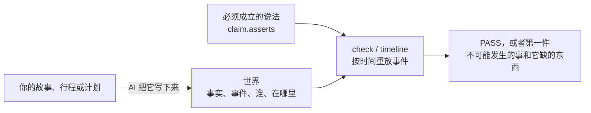

# WorldGuard

<!-- README HERO START -->
<p align="center">
  
</p>
<!-- README HERO END -->

<p align="center"><strong>章节一多、天数一长，AI 就记不清谁手里有什么、谁在哪里，写出根本不可能发生的事。WorldGuard 把 AI 记下的事件按时间重放一遍，指出第一件不可能发生的事，以及它缺了什么。</strong></p>

| 版本 | 运行环境 | 包名 |
| --- | --- | --- |
| `v0.8.0` | Python 3.11+，PyYAML | `worldguard` |

[English](./README.md)

WorldGuard 是一个 Python 工具，也是一个 AI 技能（Claude Code、Codex 都能用）。AI 把故事、行程、计划或流程写成一个小小的
“世界”：一开始什么为真，有哪些事件、各在什么时间，每件事需要什么前提、改变了什么，以及哪些说法必须成立。重放事件、
检查每条说法的是工具，不是 AI。它从不读正文，只检查 AI 写下来的这个世界。

## 30 秒看懂：灯塔的钥匙

AI 起草了两章：

> **第 1 章。** 9:00，Lena 在灯塔里找到一把黄铜钥匙。12:00，她用它锁上了门。14:00，她坐渡船去了大陆。
>
> **第 2 章。** 18:00，在港口咖啡馆，Lena 把钥匙交给了 Tom。20:00，Tom 坐晚班渡船上岛。21:00，*Lena 转动黄铜钥匙，
> 灯塔的门开了。*

**没有 WorldGuard**，最后这句就这样交出去了。可钥匙已经不在 Lena 手里，她人也还在大陆上。

**用 WorldGuard**，AI 把第 2 章写成一个世界。每个事件写明谁来做、发生之前什么必须为真（`requires`）、发生之后改变了什么；
钥匙在谁手里、人在哪里，都是由事件开始和结束的事实。下面是 `tests/fixtures/trials/lighthouse_key/ch2.yaml` 里的事件：

```yaml
inputs:
  event_model: {initial_states: [lena_on_mainland, lena_has_key, door_locked, tom_on_mainland]}
  events:
    - {event_id: e_give_key, at: "18:00", source: ch2 p1, actor: Lena, with: [Tom], requires: [lena_has_key, lena_on_mainland, tom_on_mainland], initiates: [tom_has_key], terminates: [lena_has_key]}
    - {event_id: e_tom_ferry, at: "20:00", source: ch2 p2, actor: Tom, requires: [tom_on_mainland], initiates: [tom_on_island], terminates: [tom_on_mainland]}
    - {event_id: e_unlock, at: "21:00", source: ch2 p3, actor: Lena, requires: [lena_has_key, lena_on_island, door_locked], initiates: [door_unlocked], terminates: [door_locked]}
```

同一个文件里还写着这一章的说法：钥匙先换了手，门才被打开；21:00 门是开着的。然后 AI 把这个世界读回来：


```console
$ python skills/worldguard/scripts/run_worldguard.py timeline --contract tests/fixtures/trials/lighthouse_key/ch2.yaml
world ch2 (clock: clock)
claim ch2_door_opened row 0: event e_give_key before e_unlock PASS
claim ch2_door_opened row 1: holds door_unlocked at 21:00 FAIL CLAIM_ASSERTION_FALSE
start  -  fluents: door_locked, lena_has_key, lena_on_mainland, tom_on_mainland | tokens: -
18:00  e_give_key  fluents: +tom_has_key -lena_has_key | tokens: = (source: ch2 p1)
20:00  e_tom_ferry  fluents: +tom_on_island -tom_on_mainland | tokens: = (source: ch2 p2)
21:00  e_unlock  fluents: = | tokens: = (source: ch2 p3)  !! EVENT_PRECONDITION_UNMET
```

21:00 那件事不可能发生，所以门根本没开，这一章自己的说法（“21:00 门是开着的”）也就不成立。`check` 会把原因说全，
下面是它的报告里关于这件事的那一段：


```console
$ python skills/worldguard/scripts/run_worldguard.py check --contract tests/fixtures/trials/lighthouse_key/ch2.yaml
...
      "code": "EVENT_PRECONDITION_UNMET",
      "counterexample": {
        "at": "21:00",
        "event_id": "e_unlock",
        "holding_fluents": [
          "door_locked",
          "lena_on_mainland",
          "tom_has_key",
          "tom_on_island"
        ],
        "missing_fluents": [
          "lena_has_key",
          "lena_on_island"
        ],
        "source": "ch2 p3"
      },
...
  "status": "FAIL"
}
```

Lena 既没有钥匙，也不在岛上；钥匙在 Tom 手里，Tom 正好在岛上。改法是让 Tom 去开门（同一目录里的 `ch2_fixed.yaml`），
检查就通过了。

## 快速上手

**1. 从发布的 tag 安装技能。**

```bash
git clone --depth 1 --branch v0.8.0 https://github.com/liuyingxuvka/WorldGuard.git
python -m pip install PyYAML
python WorldGuard/scripts/install_skill.py --target ~/.claude/skills          # Claude Code
python WorldGuard/scripts/install_skill.py --target ~/.codex/skills           # Codex (or "$CODEX_HOME/skills")
python WorldGuard/scripts/install_skill.py --target ~/.claude/skills --check  # is the installed copy current?
```

安装脚本把 `skills/worldguard/` 复制到 `<目标>/worldguard/`，并把 `worldguard/` 这个包放在旁边的 `runtime/` 里，
所以装好的技能可以独立运行：`python <目标>/worldguard/scripts/run_worldguard.py`。只需要 PyYAML（用 JSON 写的世界连它都不需要）。

**2. 可选：`worldguard` 命令**，同一个 tag：

```bash
python -m pip install "git+https://github.com/liuyingxuvka/WorldGuard.git@v0.8.0"
```

装好后有 `worldguard` 命令（四个子命令：`check`、`mesh-check`、`timeline`、`compare`），以及 Python 接口（`GuardContract`、`ModelMeshContract`、
`run_worldguard`、`run_model_mesh`）。

**3. 先跑这三条**，在克隆下来的目录里：

```bash
cd WorldGuard
python skills/worldguard/scripts/run_worldguard.py timeline --example trip
python skills/worldguard/scripts/run_worldguard.py check --example scene
python skills/worldguard/scripts/run_worldguard.py mesh-check --example story
```

`timeline` 把一个世界一步一步读回来；`check` 检查一个世界和它的说法；`mesh-check` 检查一棵由章节或天数组成的树。
`--example` 用到的世界在 `skills/worldguard/assets/examples/` 里，复制一个来改，就是你自己的起点。

## 它是怎么工作的



技能让 AI 分五步建一个世界：先写必须成立的说法（`claim.asserts`）；只加这些说法用得到的输入（事件、地点和物品、空间关系、
因果）；给每条重要的说法配一个“已知坏”的改法（`variants:`），这个改法必须让它失败；有好几章或好几天时，建一棵树，
每章一个节点，按阅读顺序连起来；还没写的那一章，先放一个没有世界的节点（`GAP planned`）。

说法决定跑哪些检查：事件和时间、人物和意图、地点、物品、因果、冲突、规范。结果按严重程度排：`FAIL` > `GAP` >
`BOUNDARY_EXCEEDED` > `PASS`。已知的矛盾就是失败，缺了输入就是缺口，绝不算通过。`check` 和 `mesh-check` 通过时退出 0，
没通过退出 1，输入有错退出 2。

计划也可以拿去对照实际发生的事。`compare` 只比较你给它的实际时间和数值；加 `--write-observed` 会写出一份只替换所观测事件时间的独立副本，其他输入保持原样。
检查这份副本，就能看出这些时间是否打破了声明的条件：


```bash
python skills/worldguard/scripts/run_worldguard.py compare --contract world.yaml --observed log.yaml
python skills/worldguard/scripts/run_worldguard.py compare --contract world.yaml --observed log.yaml --write-observed actual.json
python skills/worldguard/scripts/run_worldguard.py check --contract actual.json
```

### 多章：一棵树

一章自己可以前后一致，却和上一章对不上。比如 AI 写第 2 章时，让 Lena 一开始就在岛上（忘了她坐渡船走了）。
第 2 章单独检查是通过的；树把第 1 章的结尾接到第 2 章的开头，就抓住了：


```console
$ python skills/worldguard/scripts/run_worldguard.py timeline --mesh tests/fixtures/trials/lighthouse_key/mesh_slip.yaml | head -3
story PASS (tree FAIL)
  ch1 PASS -> continues ch2 FAIL MESH_HANDOFF_STATE_MISMATCH
  ch2 PASS
```

从 `v0.8.0` 起，两章之间的交接只比较两章都提到的事实。第 2 章才出场的人物（Tom）不再被当成“第 1 章结束时不在大陆”；
树的 `scope_limits` 会写一行，说第 2 章开头有一个第 1 章从没提过的事实，这个假设仍然看得见。


## 和其他 Guard 技能怎么配合

**WorldGuard → LogicWriting，通过存下的检查报告。** 故事或旅行攻略要写成给真实读者看的成品时，由 LogicWriting 来写，
它把写作计划绑到世界上：计划写明世界文件，以及正文每一部分依赖哪些事件；收尾时，只有一份属于当前世界文件的 WorldGuard
报告存在，正文才算过关。从 `v0.8.0` 起，`mesh-check` 的报告带着和单个世界的报告同类的身份信息：这棵树的 `mesh_id`，以及它读过的每个文件的摘要
（`input_digests`）。支持这种树身份的使用方能判断报告是否还属于当前文件，并把整棵章节树当成一个世界来绑定。
LogicWriting 当前版本具体接受哪些格式，见[它的 README](https://github.com/liuyingxuvka/LogicWriting)。WorldGuard 自己从不写正文，也从不调用 LogicWriting。


WorldGuard 管故事、行程、计划和流程。软件代码和它的行为，用 FlowGuard。

<!-- BEGIN GUARD FAMILY TABLE -->
## Guard 技能家族

五个技能，同一个思路：让 AI 的答案去对照明确的模型或证据记录；AI 容易出错的那一步，交给工具来做，而不是让 AI 自己做。每个技能都可以单独用。技能之间唯一的数据交接，是 LogicWriting 读取 ResearchGuard 和 WorldGuard 存下的报告。

| 技能 | 它弥补 AI 的哪个弱点 | 什么时候用 | 和其他技能怎么配合 |
|---|---|---|---|
| [FlowGuard](https://github.com/liuyingxuvka/FlowGuard) | 改了软件的一处，看不到别处因此坏了；把已经有的东西再写一遍，或者把新代码放错地方 | 修改、扩展、重构或审查软件代码，包括仿真程序本身的代码 | 计算结果交给 PhysicsGuard，因果结论交给 ResearchGuard，故事或计划的前后一致交给 WorldGuard，长文交给 LogicWriting。另外四个 Guard 自己也是用 FlowGuard 开发的 |
| [PhysicsGuard](https://github.com/liuyingxuvka/PhysicsGuard) | 在脑子里算物理，单位、正负号、守恒算错了还说得很肯定 | 数字来自物理：仿真结果、试验数据，或者 AI 自己算的一道题 | 仿真程序的代码交给 FlowGuard。没有别的技能读它的报告 |
| [ResearchGuard](https://github.com/liuyingxuvka/ResearchGuard) | 讲出一个很有把握的因果故事，资料其实撑不住 | 说出一个因果或证据上的结论之前：论点、来源、时间线、几种互相竞争的解释 | LogicWriting 读取它存下的状态报告。把结论写成完整的报告，交给 LogicWriting |
| [WorldGuard](https://github.com/liuyingxuvka/WorldGuard) | 跨章节、跨天、跨步骤时，忘了谁手里有什么、谁在哪里，写出不可能发生的事 | 一个故事、行程、计划或流程，要每一步都前后一致 | LogicWriting 读取它存下的检查报告。软件代码交给 FlowGuard |
| [LogicWriting](https://github.com/liuyingxuvka/LogicWriting) | 长文写着写着，偏离了自己的提纲和证据 | 要一篇给真实读者看的成品：调查报告、论文、小说或故事提纲、旅行攻略 | 读取 ResearchGuard 和 WorldGuard 存下的报告。只检查论点、不写成文，交给 ResearchGuard |
<!-- END GUARD FAMILY TABLE -->

## 实话实说：它的局限

**它不做的事。**
- 它从不读正文，只检查 AI 写下来的世界；这个世界和正文是否一致，是 AI 的责任。事件上的 `source:` 只是指向原文的位置，
  不做检查。
- `PASS` 只对声明的世界和它的范围成立，不代表现实如此。WorldGuard 不是物理求解器，不做法律判断，不是安全证书，也不预测市场。

**它仍可能漏掉的。** 如果 AI 把故事里的错误原样写进了世界，世界本身是自洽的，什么也不会失败。在下面说的试验里，AI 写的
开门事件一开始只要求“门是锁着的”，这一章就通过了。从 `v0.8.0` 起，一个事件的执行者在世界里有被记着的状态（Lena 的钥匙、
Lena 在哪里），而这个事件的 `requires` 一条都没要求，就是 `GAP EVENT_ACTOR_STATE_UNCHECKED`；如果这件事确实和这些都无关，
就写上 `actor_state_free: <理由>`，报告会把理由印出来。这项检查把执行者 ID 与事实名中的完整字母数字片段做忽略大小写的匹配；只要求一个匹配的事实就足够了。
事件还需要哪些前提，以及漏写进世界的事实，仍由建模者负责。


**测过什么，没测过什么。**
- 设计包报告：本版本设计期间做过一次小试验，就是上面两章灯塔故事，埋了一个错误。WorldGuard 点出了那件不可能的事，以及它缺的
  正是什么；章节交界处的错误只有树能抓住；把同一个错误写进世界本身（开门只要求门锁着）时，检查通过了，这就是本版本加了
  执行者状态检查的原因。同一次试验还发现，第 2 章才出场的人物会被误报为交接不一致，本版本已修正。
- 设计包报告：把两章写成世界，用的 YAML 字符数大约是故事本身的三倍；读和写加起来大约 9,000 个 token。
- 没测过：执行者状态检查在没有错误的故事上会误报多少。目前只在试验的几章和仓库自带的世界上试过，在那里它只抓出了埋下的那个错误。


## 开发 WorldGuard

日常运行 FlowGuard 选中的受影响测试和模型；最终冻结的源码由 CI 运行全套测试（`python -m pytest -q`），无需只为重复同一源码的 CI 再本地全跑一次。

```bash
python -m pip install -e ".[test]"
python -m flowguard change --run
```

`test` 这一组会装上 pytest 和 FlowGuard：WorldGuard 用 FlowGuard 维护自己，这一组里钉着本版本开发时用的 FlowGuard 版本。
FlowGuard 只从它的 git tag 安装（`git+https://github.com/liuyingxuvka/FlowGuard.git@<tag>`），因为 PyPI 上同名的包是另一个项目。
平常使用 WorldGuard 不需要 FlowGuard。参与开发的 AI 从 [`AGENTS.md`](./AGENTS.md) 读起；`CLAUDE.md` 让 Claude Code
读同一个文件。`worldguard/` 是运行时，`skills/worldguard/` 是技能、参考文档和示例世界，`tests/` 是测试，
`openspec/specs/` 是规格说明。


## 链接

- 技能：[`SKILL.md`](./skills/worldguard/SKILL.md) 和它的参考文档：
  [合同和结果](./skills/worldguard/references/worldguard-contracts.md)、
  [各个 Guard 的输入](./skills/worldguard/references/guard-inputs.md)、
  [由章节或天数组成的树](./skills/worldguard/references/model-mesh.md)
- 示例世界：[`skills/worldguard/assets/examples/`](./skills/worldguard/assets/examples/scene_locked_door.yaml)
- [更新记录](./CHANGELOG.md)
- 仓库里没有许可证文件；源码公开不等于可以不受限制地复用。
